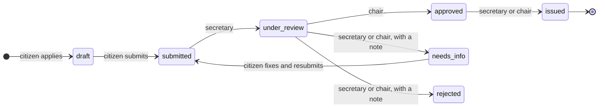

# Ward Sewa (वडा सेवा)

Citizens of Nepal apply online for a ward-office recommendation letter (_sifaris_), such as proof
of residence. Ward staff review and approve it, and the ward issues a numbered PDF letter with a
QR code that anyone can scan to check it is genuine.

Built in Nepali and English, on Bikram Sambat dates and Nepal time, with every one of the country's
753 local levels and 6,743 wards.

**Stack:** TypeScript · Node.js 24 + Express 5 · React 19 + TanStack Router/Query · PostgreSQL ·
Redis + BullMQ · MongoDB · Docker Compose · GitHub Actions. **290 automated tests**, 125 of them
against real databases.

## Try it in five minutes

Needs only Docker.

```sh
git clone https://github.com/JenishSambahamphe24/ward-sewa.git && cd ward-sewa
docker compose up -d --build --wait          # 7 services; the first build takes a few minutes
docker compose run --rm -e NODE_ENV=development api node apps/api/src/cli/seed-demo.ts
```

Open **http://localhost:8080**. Login is by phone number and a one-time code. No SMS is sent in
development; the code is written to the API log:

```sh
docker compose logs -f api | grep "login code"
```

| Log in as                         | Phone      | What to do                                               |
| --------------------------------- | ---------- | -------------------------------------------------------- |
| Citizen                           | 9800000001 | Apply in **Kathmandu, ward 5**, upload documents, submit |
| Ward secretary (Kathmandu ward 5) | 9851000005 | Queue → open it → Start review                           |
| Ward chair (Kathmandu ward 5)     | 9851000006 | Under review → Approve → Issue letter                    |
| Municipality admin (Kathmandu)    | 9841000001 | Staff: assign, move or deactivate ward staff             |

Then download the letter as the citizen and open **Verify a letter** with the code printed under
its QR code. Each phone number can request 3 codes per 15 minutes.

## What it does



- **Citizen:** picks an address from cascading lists (province → district → municipality → ward),
  a letter type with its own fields and required documents, saves a draft, uploads documents,
  submits, follows a timeline with staff notes, and downloads the letter.
- **Ward secretary and chair:** work a queue for their own ward only. Only the chair approves,
  because the chair signs. Either can issue an approved letter.
- **Municipality admin** (the municipality's IT officer): assigns and moves staff within their own
  municipality and deactivates them. Cannot review or approve anything (separation of duties).
- **Anyone:** verifies a letter at `/verify/<code>` without logging in.

## Architecture


| Store          | Holds                                                                    | Why this store                                                     |
| -------------- | ------------------------------------------------------------------------ | ------------------------------------------------------------------ |
| **PostgreSQL** | Users, applications, status history, documents, issued letters, counters | Transactions and constraints: anything that must never be wrong    |
| **Redis**      | OTP codes, sessions, cache, rate-limit counters, BullMQ jobs             | Short-lived data with expiry built in; fast counters               |
| **MongoDB**    | `audit_events`, `notification_logs`                                      | Append-only event documents of varying shape; TTL index for expiry |

```
apps/api              Express 5 REST API and the BullMQ worker (feature modules: routes → controller → service → repository)
apps/web              React citizen portal, staff and admin screens (Nepali / English, light / dark)
packages/nepal-utils  BS ↔ AD dates, Nepal time, fiscal year, Nepali numerals, all divisions (100% test coverage)
packages/config       Shared ESLint, Prettier and TypeScript presets
```

## Design decisions

**Letter numbers come from a counter row in PostgreSQL**, not a sequence and not Redis. Numbers
must be gap-free per ward and fiscal year (`2083/84-0001`): a sequence skips a number when a
transaction rolls back, and Redis could lose its count on restart. The increment, the status change
and the letter are one transaction
([letters.repository.ts](apps/api/src/modules/letters/letters.repository.ts)).

**Concurrent edits are caught with optimistic locking.** Every application has a `version`; each
update matches on it and bumps it. Two staff approving at once: the second gets `409` and the
screen reloads instead of silently overwriting
([applications.repository.ts](apps/api/src/modules/applications/applications.repository.ts)).

**The audit log uses a transactional outbox.** An event is written to PostgreSQL in the same
transaction as the change, and the worker relays it to MongoDB (`FOR UPDATE SKIP LOCKED`, outbox id
as `_id` so a retry can't duplicate it). MongoDB being down delays the log; it never loses an event
or blocks a citizen ([audit.relay.ts](apps/api/src/modules/audit/audit.relay.ts)).

**Issued letters are frozen.** The letter stores a snapshot of the applicant's name, address (with
place names) and answers. Renaming a municipality or editing a profile later never changes a letter
already issued, and verification reads the snapshot.

**Addresses are codes, never free text.** Clients send only the municipality code and ward number;
district and province are derived, so they can't contradict each other, and a foreign key rejects a
ward that doesn't exist. Codes are UN OCHA P-codes from Survey Department data.

**Nepal time, not server time.** "Today" for a letter date or fiscal year is computed in UTC+05:45
whatever timezone the server runs in, and dates are shown in Bikram Sambat
([bs-date.helper.ts](packages/nepal-utils/src/bs-date.helper.ts)).

**OTP login without storing secrets.** Codes are stored as an HMAC with a 5-minute expiry and an
attempt limit; sessions are stored as `sha256(token)`. The user's role and active flag are read from
PostgreSQL on every request, so deactivating staff takes effect on their next click
([otp.store.ts](apps/api/src/modules/auth/otp.store.ts),
[session.store.ts](apps/api/src/modules/auth/session.store.ts)).

**Safe retries.** `POST /applications` accepts an `Idempotency-Key`: a retry after a lost response
returns the original application instead of creating a second one
([idempotency.ts](apps/api/src/middleware/idempotency.ts)).

**Redis is never a single point of failure.** The cache falls back to the database, and rate limits
fail open, both with a warning in the log ([cache.ts](apps/api/src/lib/cache.ts),
[rate-limit.ts](apps/api/src/middleware/rate-limit.ts)).

**Uploads are checked by their bytes**, not their file name or the browser's MIME type, limited to
5 MB, stored under random keys and served back as attachments with `nosniff`.

**Live and ready health checks are separate.** `/health/live` only says the process runs;
`/health/ready` pings all three stores. A database outage takes the API out of the load balancer
without making the orchestrator restart every container.

**Money is a string.** Fees are `numeric(12, 2)` in PostgreSQL and strings everywhere else, so no
amount ever passes through a binary float.

**One origin in production.** nginx serves the site and forwards `/api` to the API, as Vite does in
development: no CORS, and the API trusts exactly one proxy hop for the client IP.

## Tests

```sh
pnpm install
docker compose up -d --wait postgres mongo redis
pnpm test                 # 165 unit and component tests
pnpm test:integration     # 125 API tests against real PostgreSQL, Redis and MongoDB
```

The integration tests use no mocks for the databases. Among them: a citizen can't read another
citizen's application; ward 7 staff can't see ward 5's; two simultaneous approvals produce exactly
one `409`; the same idempotency key creates one application; an OTP expires after 5 minutes; a
municipality admin can't approve or manage another municipality's staff; deactivated staff are
refused on their next request; a citizen renaming themselves doesn't change a letter already
issued; an audit event is never lost or duplicated while MongoDB is failing.

CI runs lint, format, typecheck, every test (with a 100% coverage threshold on `nepal-utils`), the
web build, and boots the whole Docker Compose stack, checking the site and the API through nginx.

## Development

Requires Node 24, pnpm and Docker.

```sh
pnpm install
cp .env.example .env
docker compose up -d --wait postgres mongo redis
pnpm --filter @ward-sewa/api db:migrate      # tables, plus the 753 local levels and 6,743 wards
pnpm --filter @ward-sewa/api seed:demo       # the demo accounts above
pnpm dev                                     # API on :3000, web on :5173 with hot reload
pnpm --filter @ward-sewa/api dev:worker      # letter PDFs and the audit relay
```

TypeScript runs without a build step on the server: Node 24 strips types at runtime and `tsc` only
type-checks. Every dependency version lives in one place, the catalogs in `pnpm-workspace.yaml`.
Redis is on host port 6380.

## Data sources

- Provinces, districts and local levels: Survey Department of Nepal, _Nepal Subnational
  Administrative Boundaries_, via OCHA HDX (CC BY-IGO 3.0).
- Ward counts: National Statistics Office, _National Population and Housing Census 2021_.
- Both are imported by a script that records the source URL and checksum in
  [divisions.json](packages/nepal-utils/src/data/divisions.json); none of it is typed by hand.

## Not in this version

- SMS is written to the log instead of sent; the provider would plug in behind the `SmsGateway`
  interface.
- Municipality names are shown in English in both languages: the official dataset has no Nepali
  names.
- The BS calendar table has not yet been checked against an official printed calendar.
- Pre-2017 (VDC) addresses.
