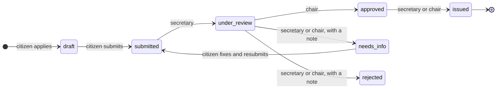
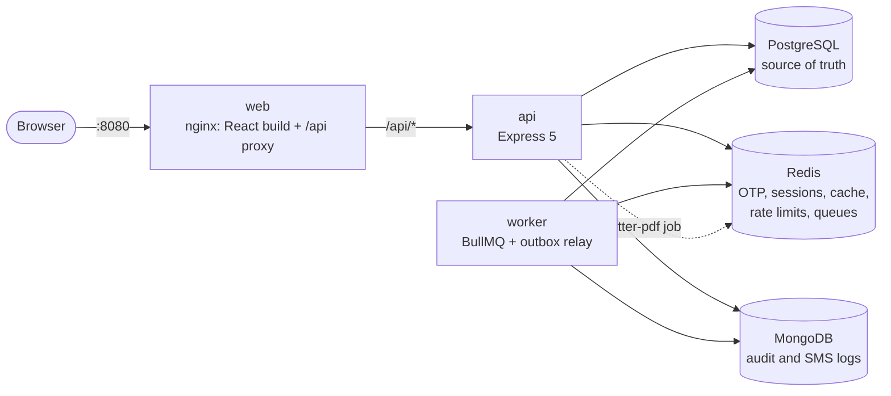

# Ward Sewa (वडा सेवा)

Citizens of Nepal apply online for a ward-office recommendation letter (_sifaris_), such as proof
of residence. Ward staff review and approve it, and the ward issues a numbered PDF letter with a
QR code that anyone can scan to check it is genuine.

Built in Nepali and English, on Bikram Sambat dates and Nepal time, with every one of the country's
753 local levels and 6,743 wards.

**Stack:** TypeScript · Node.js 24 + Express 5 · React 19 + TanStack Router/Query · PostgreSQL ·
Redis + BullMQ · MongoDB · Docker Compose · GitHub Actions. **294 automated tests**, 125 of them
against real databases.

## Try it in five minutes

Needs only Docker.

```sh
git clone https://github.com/JenishSambahamphe24/ward-sewa.git && cd ward-sewa
docker compose up -d --build --wait          # 7 services; the first build takes a few minutes
docker compose run --rm -e NODE_ENV=development api node apps/api/src/cli/seed-demo.ts
```

Open **http://localhost:8080**. Login is by phone number and a one-time code. No SMS is sent in
development; the code is written to the API log:

```sh
docker compose logs -f api | grep "login code"
```

| Log in as                         | Phone      | What to do                                               |
| --------------------------------- | ---------- | -------------------------------------------------------- |
| Citizen                           | 9800000001 | Apply in **Kathmandu, ward 5**, upload documents, submit |
| Ward secretary (Kathmandu ward 5) | 9851000005 | Queue → open it → Start review                           |
| Ward chair (Kathmandu ward 5)     | 9851000006 | Under review → Approve → Issue letter                    |
| Municipality admin (Kathmandu)    | 9841000001 | Staff: assign, move or deactivate ward staff             |

Then download the letter as the citizen and open **Verify a letter** with the code printed under
its QR code. Each phone number can request 3 codes per 15 minutes.

**API documentation:** http://localhost:8080/api/docs (Swagger UI, OpenAPI 3.1). Log in with the two
`/auth/otp` calls, then paste the token into **Authorize** to try any endpoint.

## What it does



- **Citizen:** picks an address from cascading lists (province → district → municipality → ward),
  a letter type with its own fields and required documents, saves a draft, uploads documents,
  submits, follows a timeline with staff notes, and downloads the letter.
- **Ward secretary and chair:** work a queue for their own ward only. Only the chair approves,
  because the chair signs. Either can issue an approved letter.
- **Municipality admin** (the municipality's IT officer): assigns and moves staff within their own
  municipality and deactivates them. Cannot review or approve anything (separation of duties).
- **Anyone:** verifies a letter at `/verify/<code>` without logging in.

## Architecture



| Store          | Holds                                                                    | Why this store                                                     |
| -------------- | ------------------------------------------------------------------------ | ------------------------------------------------------------------ |
| **PostgreSQL** | Users, applications, status history, documents, issued letters, counters | Transactions and constraints: anything that must never be wrong    |
| **Redis**      | OTP codes, sessions, cache, rate-limit counters, BullMQ jobs             | Short-lived data with expiry built in; fast counters               |
| **MongoDB**    | `audit_events`, `notification_logs`                                      | Append-only event documents of varying shape; TTL index for expiry |

```
apps/api              Express 5 REST API and the BullMQ worker (feature modules: routes → controller → service → repository)
apps/web              React citizen portal, staff and admin screens (Nepali / English, light / dark)
packages/nepal-utils  BS ↔ AD dates, Nepal time, fiscal year, Nepali numerals, all divisions (100% test coverage)
packages/config       Shared ESLint, Prettier and TypeScript presets
```

## Development

Requires Node 24, pnpm and Docker.

```sh
pnpm install
cp .env.example .env
docker compose up -d --wait postgres mongo redis
pnpm --filter @ward-sewa/api db:migrate      # tables, plus the 753 local levels and 6,743 wards
pnpm --filter @ward-sewa/api seed:demo       # the demo accounts above
pnpm dev                                     # API on :3000, web on :5173 with hot reload
pnpm --filter @ward-sewa/api dev:worker      # letter PDFs and the audit relay
```

TypeScript runs without a build step on the server: Node 24 strips types at runtime and `tsc` only
type-checks. Every dependency version lives in one place, the catalogs in `pnpm-workspace.yaml`.
Redis is on host port 6380.

## Not in this version

- SMS is written to the log instead of sent; the provider would plug in behind the `SmsGateway`
  interface.
- Municipality names are shown in English in both languages: the official dataset has no Nepali
  names.
- The BS calendar table has not yet been checked against an official printed calendar.
- Pre-2017 (VDC) addresses.
